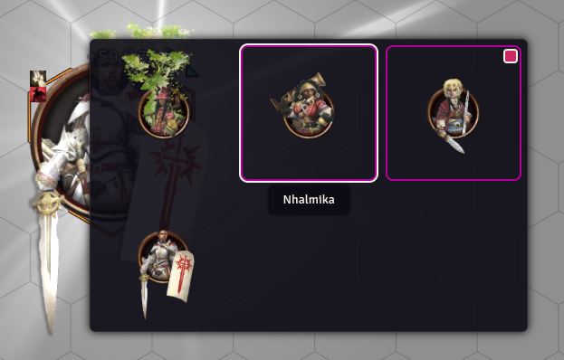

> **AI Disclaimer** - This module was created with the heavy use of AI coding. I have credited the AI model used as an author. Manual reviews and changes were made many times during the creation of this module.

# Token Stack Picker

This module aims to make it easier to target or open sheets of tokens that are on top of each other. This should work on all systems but is used and tested on the PF2e and SF2e systems. If you are looking for a particular feature or are having an issue please open up an `Issue`!



## Usage

1. Hover over a stack of tokens on the canvas
2. Press `G` to open a window that shows a grid of portraits for each visible token under the cursor
3. Perform one of the following when over a token's portrait:
- Left Click: Toggle targeting on the token
- Right Click: Open the token's actor sheet if you have permission to do so and close the window
- Press Core Target Keybind or Module Keybind if Core Target Keybind is not set: Toggle targeting on the token
4. Close the window by doing any of the following:
- Press Escape
- Move the pointer or click outside the window
- Pan or Zoom the canvas
- Change the scene
- Tab out of browser

## Token Portraits

The token portraits have the following elements:
- Target highlight border: you are targeting the token this portrait belongs to
- Hover outline: The portrait under your pointer
- Colored pips: Other users who are also targeting this token

## Settings

| Setting       | Scope  | Default   | Description                                                                   |
| ------------- | ------ | --------- | ----------------------------------------------------------------------------- |
| Use Actor Art | World  | `Off`     | Show actor images instead of token images                                     |
| Portrait Size | Client | `100`     | Size in pixels of each token portrait in the grid (50 to 200, in steps of 10) |
| Grid Columns  | Client | `3`       | Maximum number of portraits per row in the grid (1 to 6)                      |
| Target Color  | Client | `#ff6400` | Color of the highlight around targeted tokens                                 |

## Keybindings

| Action                  | Default | Description                                                        |
| ----------------------- | ------- | ------------------------------------------------------------------ |
| Open Token Stack Picker | `G`     | Open the token stacker picker window at the current mouse position |

## API

Macros can open the token stack picker window with the provided API:
```js
const api = game.modules.get('token-stack-picker').api;
// At the current mouse position
api.open();
// At a specific point, in canvas (scene) coordinates
api.open({ x: 1200, y: 800 });
```

## Languages

- English